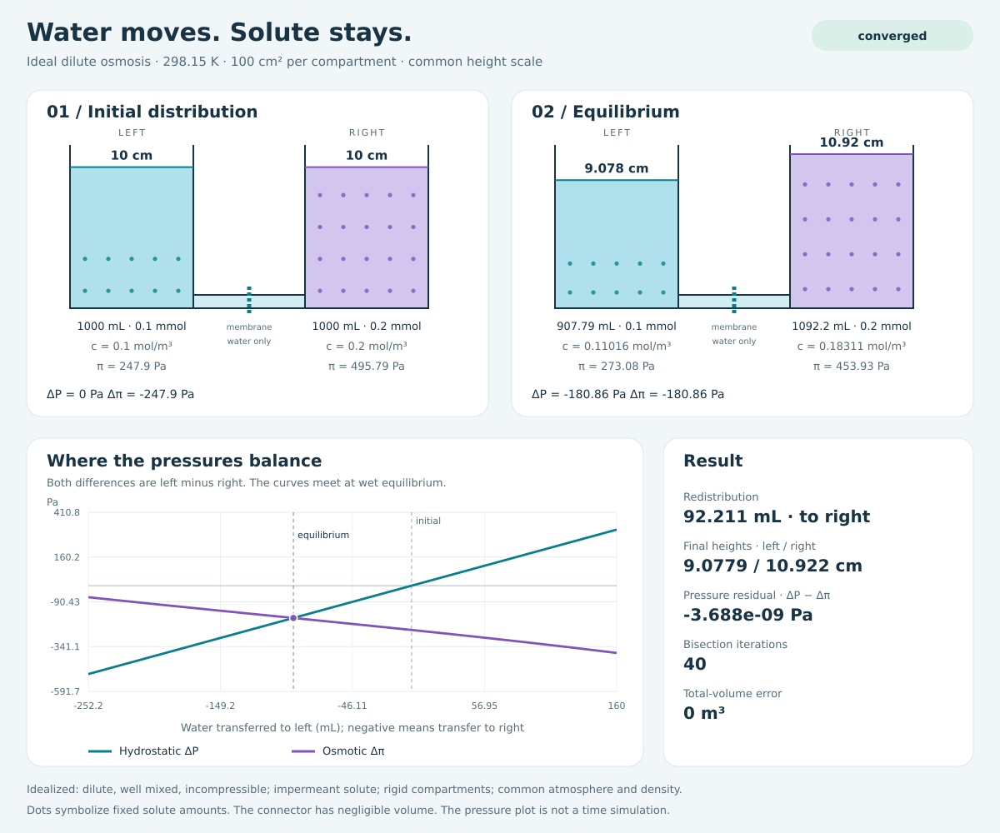

# Osmotic Membrane Equilibrium

A small Python model of water redistribution between two rigid, equal-area
compartments separated by a membrane that passes water but retains solute.
Requires Python 3.10 or later; the runtime has no third-party dependencies.



## Run an experiment

Install and run from PowerShell:

```powershell
python -m venv .venv
.\.venv\Scripts\python.exe -m pip install -e .
.\.venv\Scripts\osmotic-equilibrium.exe solve
.\.venv\Scripts\python.exe -m osmotic_membrane_equilibrium solve --json
.\.venv\Scripts\Activate.ps1
```

The default experiment starts with 1000 mL on each side, 0.1 mmol of solute
particles on the left and 0.2 mmol on the right, 100 cm² area per compartment,
and a temperature of 298.15 K. Customize the experiment with unit-labelled flags:

```powershell
python -m osmotic_membrane_equilibrium solve --left-volume-ml 750 --right-volume-ml 1250 --temperature-k 310
python -m osmotic_membrane_equilibrium solve --json --output artifacts/solution.csv
python -m osmotic_membrane_equilibrium solve --svg artifacts/equilibrium.svg
python -m osmotic_membrane_equilibrium sweep-temperature --start-k 278.15 --stop-k 338.15 --points 13 --output artifacts/temperature.csv
python -m osmotic_membrane_equilibrium sweep-concentration --start-mol-m3 -0.2 --stop-mol-m3 0.2 --points 21 --output artifacts/concentration.csv
```

Use the virtual environment's Python, or activate it as above, for these commands.
Each subcommand supports `--help`. CSV and JSON contain all initial and final
state values, individual osmotic pressures, signed pressure and concentration
differences, volume error, transfer, solver iterations, final bracket width, and
pressure residual. Column names include their SI units. One mol/m³ equals one
mmol/L; one mol/L equals 1000 mol/m³.

The default experiment transfers **92.2114 mL from left to right**:

| Metric | Initial | Equilibrium |
| --- | ---: | ---: |
| Left height (cm) | 10 | 9.07789 |
| Right height (cm) | 10 | 10.92211 |
| Left concentration (mol/m³) | 0.1 | 0.110158 |
| Right concentration (mol/m³) | 0.2 | 0.183115 |
| Osmotic pressure difference (Pa) | -247.896 | -180.857 |
| Hydrostatic pressure difference (Pa) | 0 | -180.857 |

It converges in 40 bisection iterations with a pressure residual below
`4e-9 Pa` and zero total-volume error at displayed precision. Final
concentrations remain different because the water-height difference supplies
the balancing pressure.

## Sweeps and output

Temperature sweeps hold solute amounts, initial volumes, and geometry fixed.
Concentration sweeps hold the arithmetic mean of initial concentrations fixed
and vary **right minus left** concentration. This sweep coordinate has the
opposite sign to the left-minus-right state differences. Concentrations must
remain nonnegative, so the sweep difference cannot exceed twice the mean in
absolute value. Different sweep experiments can have different solute amounts;
each individual experiment conserves its own amounts.

Exit codes: `0` for convergence, `1` for solver exhaustion or floating-point
precision limits, `2` for invalid arguments or file errors, and `3` for a dry
boundary. Sweeps return `1` if any numerical failure occurs, otherwise `3` if
any experiment reaches a dry boundary. Result files include these statuses.

SVG reports use a common height scale for initial and final compartments and
plot both pressure differences against candidate transferred volumes. Dots
symbolize the fixed solute amounts; the drawn connector has negligible storage
volume. These are equilibrium reports, not a physical simulation of elapsed
time. No membrane permeability or flow-rate law is assumed.

## Python API and equations

All model inputs use SI units. Solute amounts count moles of dissolved particles.
For a non-dissociating solute, these are ordinary solute moles.

```python
from osmotic_membrane_equilibrium import System, solve

result = solve(System())
print(result.status)
print(result.final.height_left_m, result.final.height_right_m)
print(result.final.residual_pa)
```

The conserved total volume is `V = V_left_initial + V_right_initial`. Bisection
finds the final left volume `v` from:

```text
rho*g*(2*v - V)/A - R*T*(n_left/v - n_right/(V - v)) = 0
```

The residual is hydrostatic pressure difference minus osmotic pressure
difference, with both differences defined as left minus right. Its derivative is
positive, so a wet equilibrium is unique when it exists. Both compartments with
positive solute amounts guarantee an interior root.

Specifically, with `0 < v < V`:

```text
h_left = v/A                   h_right = (V - v)/A
c_left = n_left/v              c_right = n_right/(V - v)
pi_left = R*T*c_left           pi_right = R*T*c_right
F'(v) = 2*rho*g/A + R*T*(n_left/v² + n_right/(V - v)²)
```

`R = 8.31446261815324 J/(mol K)`. Water is driven toward the left when
`F(v) < 0` and toward the right when `F(v) > 0`. A difference in starting heights
can therefore affect the direction as well as a concentration difference.

The bracket is initially `[0, V]`; singular solute-containing endpoints are
never evaluated. Success requires both `abs(F) <= pressure_tolerance_pa`
(default `1e-6 Pa`) and bracket width at most
`volume_tolerance_m3 + relative_volume_tolerance*V` (defaults `1e-15 m³` and
`1e-12`), or an exactly zero residual. Bisection allows 200 iterations by
default and reports exhaustion or floating-point stagnation explicitly.

With zero gravity and positive solute amounts, the analytical solution is
`v = V*n_left/(n_left + n_right)`, where concentrations become equal.
With pure water on both sides and zero gravity, every distribution is an
equilibrium, so the initial distribution is retained.

## Idealization and limits

The model assumes ideal dilute, well-mixed solutions at a common fixed
temperature, incompressible liquid with a common constant density, negligible
solute volume, equal atmospheric pressure, rigid compartments of unlimited
height, and a membrane at a common bottom reference level. It excludes membrane
deformation, solute transport, nonideal activities, and flow dynamics.

With a solute-free side, the wet equilibrium can lie beyond the available water.
The solver then reports `dry_boundary`, not convergence; the reported dry-side
concentration is its limiting value of zero. A nonzero residual can remain there,
and the wet-compartment model stops at that boundary.

The pressure law and its relation to hydrostatic counterpressure are described
in [The physical basis of osmosis, Journal of General Physiology (2023)](https://rupress.org/jgp/article/155/10/e202313332/276211/The-physical-basis-of-osmosisThe-physical-basis-of).

## Validation

Run the tests from a source checkout in PowerShell (or omit `PYTHONPATH` after
installing the package):

```powershell
$env:PYTHONPATH = "$PWD/src"
python -m unittest discover -s tests -v
```

The tests cover pressure units, input validation, total-volume and individual
solute conservation, pressure balance, symmetry under compartment exchange,
pure water, analytical zero-gravity results, dry boundaries, solver failure
statuses, fixed-parameter sweeps, CLI exit codes and unit conversions, CSV/JSON
output, and SVG structure and shared height scales. Tests use the standard
library `unittest`; no test dependencies are required.

Generated reports and local validation output belong in ignored `artifacts/`.
The reproducible default SVG is checked in at `docs/example.svg`:

```powershell
python -m osmotic_membrane_equilibrium solve --svg docs/example.svg
```

There are no GitHub Actions or workflows in this project.
